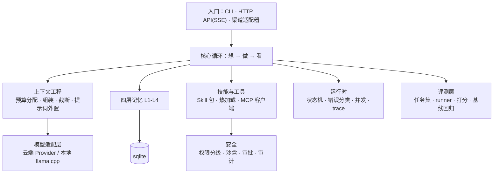
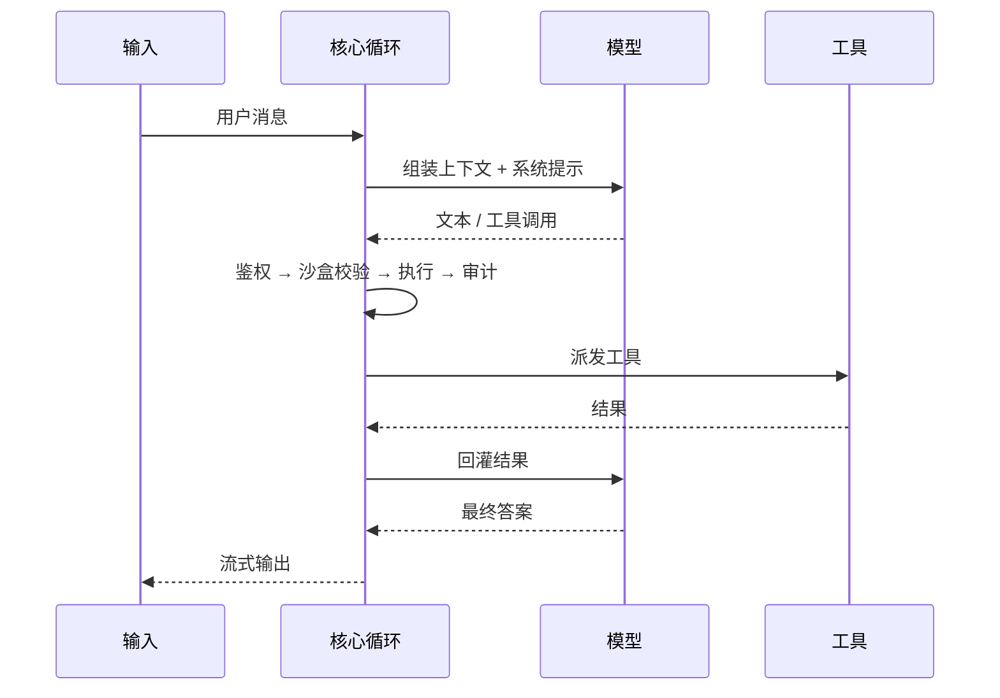

# myagent —— 轻量自建智能体框架

从零手写的智能体内核，以标准库为主、不依赖重型框架。目标是把 Agent 的"该有的部件"都亲手实现一遍：模型接入、上下文工程、记忆、工具与技能、权限与审计、评测、运行时、对外接口。

## 架构



## 核心循环



## 能力

- **模型适配层**：统一 Provider 接口 + 结果信封 + 错误码；内置云端（OpenAI 兼容 / DeepSeek）与本地（llama.cpp + GGUF）两类实现。
- **上下文工程**：token 预算分配器（分槽配额）+ 组装器（优先级出局、最近 N 轮保住）+ 超长结果截断分块 + 提示词外置（带版本/变量）。
- **四层记忆**
  - L1 会话层：append-only + 幂等 + 大对象旁路 + 重启可续聊
  - L2 语义记忆：本地 embedding + 向量检索 + 混合打分（语义/关键词/时间衰减/重要度）+ 写入筛选 + 查重 + 冲突消解（版本链）+ 作用域隔离 + 自动注入
  - L3 档案层：键值，多类型
  - L4 程序性记忆：经验写成 Markdown（可读可改）+ 索引 + 按需取用
  - 滚动摘要：保留最近 N 条原文，更早内容压成摘要（原文不删、只推指针、幂等、窗口七成触发）
- **技能生态**
  - 技能包：`SKILL.md`（YAML 头 + 正文）+ `scripts/`（stdin/stdout JSON 合同）+ `references/`
  - 注册表：目录扫描 + 原子热加载（`/reload`，坏技能不影响好的、不重启）
  - MCP 客户端：JSON-RPC over stdio（不依赖官方 SDK），接上任意 server 即获得工具，按 `annotations` 自动定级
  - 权限三级：分级表集中一处（未登记一律按最高风险处理）+ 沙盒（读写根 + 命令白名单 + 路径逃逸防护）+ 审批钩子（本次/永久/拒绝，落盘跨进程生效）
  - 审计：sqlite `audit_log` 只追加，记录 谁/何时/调了什么/参数/结果/是否获批
  - 执行唯一路径：校验 → 鉴权 → 执行 → 截断 → 结构化 → 审计
- **评测层**：任务集（YAML，可版本化）+ 批量 runner（逐条落完整轨迹）+ 规则/模型打分器 + 基线回归报告（一条命令出报告）。
- **运行时工程**：显式状态机（合法转移表）+ 错误三分类（可重试/不可重试/需人工）+ 无依赖工具并行 + 每步 trace 与费用统计 + 中断续跑。
- **入口层**：SSE 流式 HTTP API（标准库实现）+ Bearer 鉴权 + 渠道适配器（只做翻译、内核零改动）+ 会话路由（跨入口共享）+ 可安装的网页版（PWA）。

## 目录结构

```
agent/        核心循环
context/      上下文工程（预算/组装/截断/提示词）
memory/       四层记忆 + 迁移
providers/    模型适配层
runtime/      状态机 / 错误 / 并发 / trace / 配置 / 密钥
security/     权限分级 / 沙盒 / 审计
mcpclient/    MCP 客户端
skills/       技能注册表
skillpacks/   具体技能包
evals/        评测（tasks/ + runner + scorer + 基线）
entrypoints/  HTTP API / 渠道适配 / 网页版
scripts/      自检脚本
config/       配置与提示词模板
```

## 快速开始

```bash
./run.sh                      # 交互式（自动用项目 venv）
./run.sh -p "算一下 3**12"     # 单次
./run.sh -P local -p "你好"    # 指定 provider
```

CLI 内命令：`/provider` `/providers` `/model` `/tools` `/skills` `/reload` `/mcp` `/policy` `/sandbox` `/approvals` `/audit` `/budget` `/session` `/memory` `/summary` `/compact` `/trace` `/cost` `/cancel` `/api` `/quit`。

自检（不调用模型）：

```bash
python3 scripts/selftest_context.py
python3 scripts/selftest_memory.py
python3 scripts/selftest_m3.py
python3 scripts/selftest_evals.py
python3 scripts/selftest_m5.py
python3 scripts/selftest_m7.py
```

## 配置

- 主配置：`config/config.yaml`（支持 `MYAGENT__A__B=值` 环境变量覆盖）
- 密钥：只从环境变量（如 `DEEPSEEK_API_KEY`）或密钥文件读取，不落代码
- 本地模型：llama.cpp + GGUF（示例：Qwen3-4B-Q4_K_M）

## 设计取舍

- **手写而非套框架**：把状态机、记忆、工具调度、鉴权链都自己实现，便于理解每一层的行为与边界。
- **安全优先**：工具执行的默认姿态是"拒绝"，权限分级与沙盒先于执行，全程留审计。
- **可评测**：每次改动都能用任务集跑回归，量化成功率/步数/成本，而不是凭感觉。

## 说明

个人练习作品，聚焦"把 Agent 各部件亲手实现一遍"。
